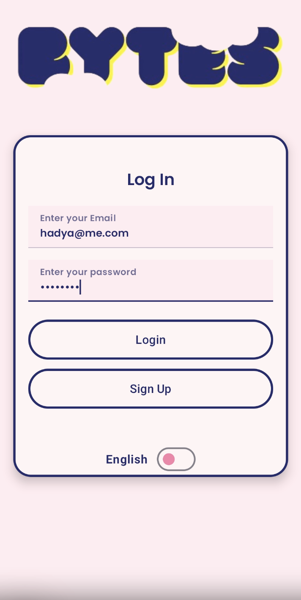
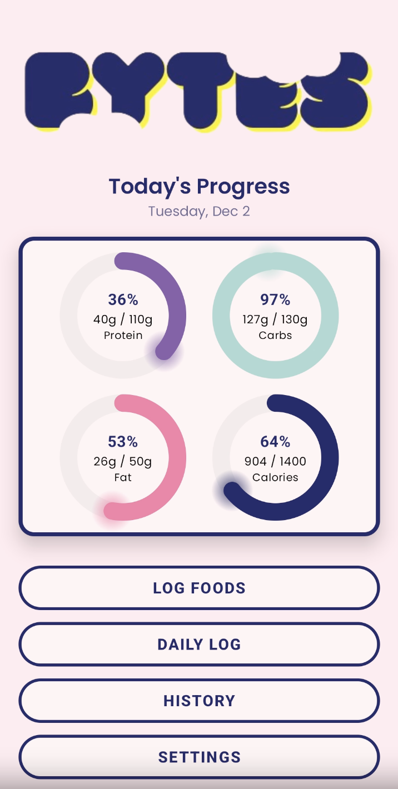
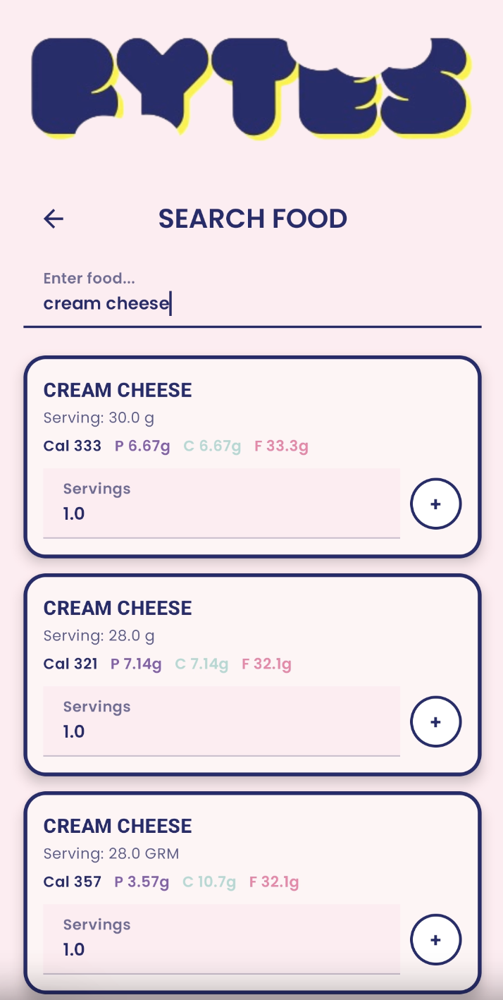
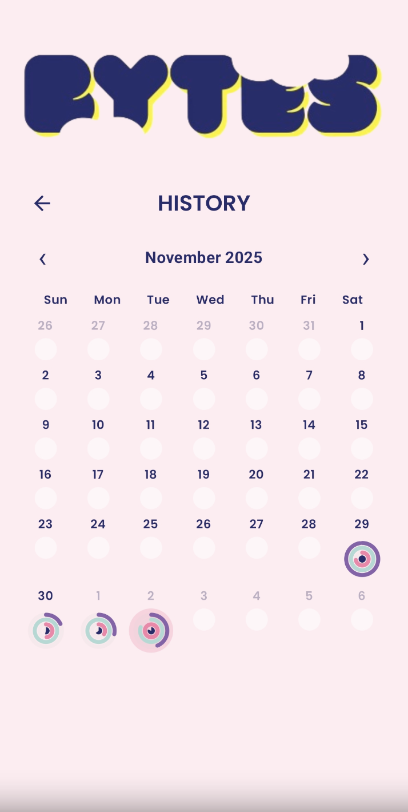

<div align="center">

# Bytes: Macro & Calorie Tracker for Android

**Search real nutrition data, log what you eat, and watch your daily macros fill up in real time.**


</div>

---

## Overview

Bytes is a native Android app for tracking calories, protein, carbs, and fat. Users search the USDA FoodData Central database, log foods with custom serving sizes, and see their progress against personal goals through animated macro rings. Every day's log syncs to the cloud, so users can browse a monthly calendar of past days and open any one for a full breakdown.


<p align="center">
  
  
  
  
</p>


## Features

- **Food search with live results.** Results update as you type, with a 400 ms debounce so the API isn't hit on every keystroke. Data comes from the USDA FoodData Central API.
- **Serving-aware logging.** Log any number of servings. Macros scale automatically, and you can edit servings or remove items afterward.
- **Macro ring dashboard.** Custom-drawn Compose `Canvas` rings show progress toward calorie, protein, carb, and fat goals, and flag when you go over a goal.
- **Monthly history calendar.** Each day shows mini multi-rings at a glance. Tap a day to see its full log and totals.
- **Cloud sync.** Logs are stored per user and per day in Cloud Firestore, and the dashboard updates live through snapshot listeners.
- **Accounts and personal goals.** Email and password sign-up and login use Firebase Authentication. New users set their calorie and macro goals during onboarding.
- **Bilingual UI.** Switch between English and Spanish on any screen. The choice persists with Jetpack DataStore.
- **Custom design system.** The Bytes brand palette, Poppins typography, and consistent card and button styling run across every screen.

## Tech Stack

| Layer | Tools |
| --- | --- |
| Language | Kotlin |
| UI | Jetpack Compose, Material 3, custom `Canvas` drawing |
| Auth | Firebase Authentication (email/password) |
| Database | Cloud Firestore |
| Networking | Retrofit + Gson, OkHttp |
| Local storage | Jetpack DataStore (Preferences), SharedPreferences |
| Async | Kotlin Coroutines, `StateFlow`, `LaunchedEffect` |
| Data source | [USDA FoodData Central API](https://fdc.nal.usda.gov/api-guide) |

## Architecture

```
app/src/main/java/firstapp/gwu/macrosproject/
├── MainActivity.kt            # Login screen, Firebase init
├── SignUpActivity.kt          # Account creation → goal setup
├── DashboardActivity.kt       # Today's macro rings + navigation (MacroRing component)
├── FoodSearchActivity.kt      # Debounced USDA search, serving input, logging
├── DailyLogActivity.kt        # Today's entries: edit servings, remove, clear
├── WeeklyHistoryActivity.kt   # Monthly calendar with per-day mini rings
├── HistoryActivity.kt         # Read-only breakdown of a past day
├── Settings.kt                # Goals, language, remember-me, sign out
├── AuthRepository.kt          # Coroutine wrappers around FirebaseAuth
├── data/
│   ├── ApiClient.kt           # Retrofit client + USDA response models
│   ├── LogRepository.kt       # Firestore-backed StateFlow of today's foods
│   ├── UserPreferences.kt     # DataStore: language + per-user goals
│   ├── DailyLog.kt            # Firestore document model
│   └── Translator.kt          # EN/ES string helper
└── ui/
    ├── components/LogoHeader.kt
    └── theme/                 # Bytes colors, Poppins typography, Material theme
```

**Data flow:** `FoodSearchActivity` calls the USDA API through Retrofit and maps the nutrient list to a `FoodItem`. `LogRepository` scales the item to the chosen servings and writes the day's `DailyLog` to `users/{uid}/logs/{yyyy-MM-dd}` in Firestore. A snapshot listener pushes changes back through a `StateFlow`, and the dashboard rings recompose automatically.

## Getting Started

### Prerequisites

- Android Studio (recent stable release)
- JDK 11+
- An Android device or emulator running Android 7.0 (API 24) or later
- A free [USDA FoodData Central API key](https://fdc.nal.usda.gov/api-key-signup)
- A Firebase project with **Email/Password Authentication** and **Cloud Firestore** enabled

### Setup

1. **Clone the repo**
   ```bash
   git clone https://github.com/hadya584/bytes-macro-tracker.git
   cd bytes-macro-tracker
   ```

2. **Connect Firebase**
   Register an Android app with package name `firstapp.gwu.macrosproject` in your Firebase project. Download its `google-services.json` and place it at `app/google-services.json`, replacing the existing file.

3. **Add your USDA API key**
   Add your key to `local.properties` in the project root. This file is gitignored, so the key never gets committed:
   ```properties
   USDA_API_KEY=your_key_here
   ```
   At build time, Gradle injects the key into `BuildConfig.USDA_API_KEY`. If no key is set, the build falls back to USDA's public `DEMO_KEY`, which works for a quick test but is heavily rate-limited.

4. **Build and run**
   Open the project in Android Studio, let Gradle sync, and run the `app` configuration. You can also build from the command line:
   ```bash
   ./gradlew installDebug
   ```

## How It Works

1. **Sign up.** Create an account, then set daily calorie, protein, carb, and fat goals.
2. **Search and log.** Type at least three characters to search. Set the number of servings and tap **+** to log.
3. **Track.** The dashboard rings fill as you log. Tap the rings card to review and edit today's entries.
4. **Look back.** Open the history calendar to see each day's progress at a glance, then tap a day for details.


<!-- Add contributors and roles, e.g.:
- **Hadya Osman** — ...
- **Mohamed ...** — ...
-->
